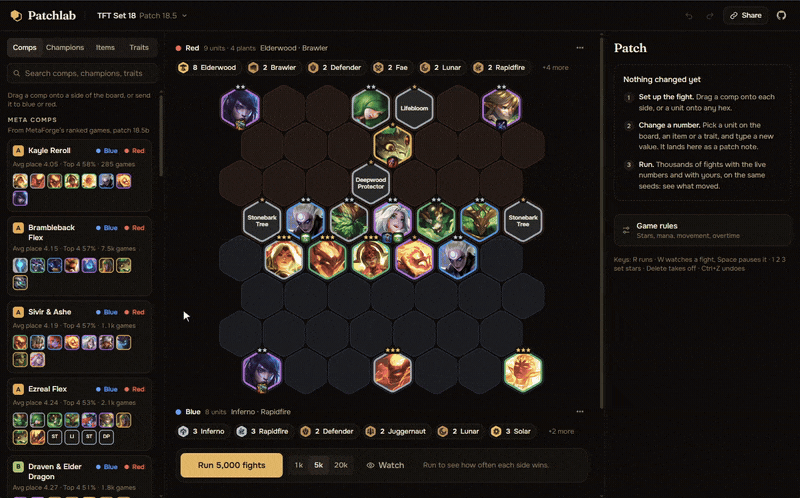
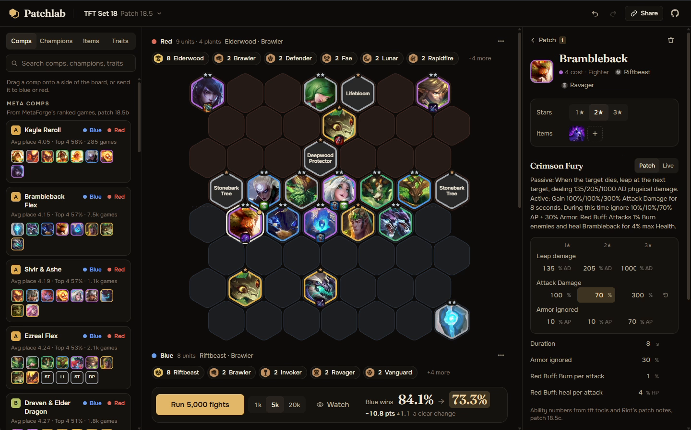
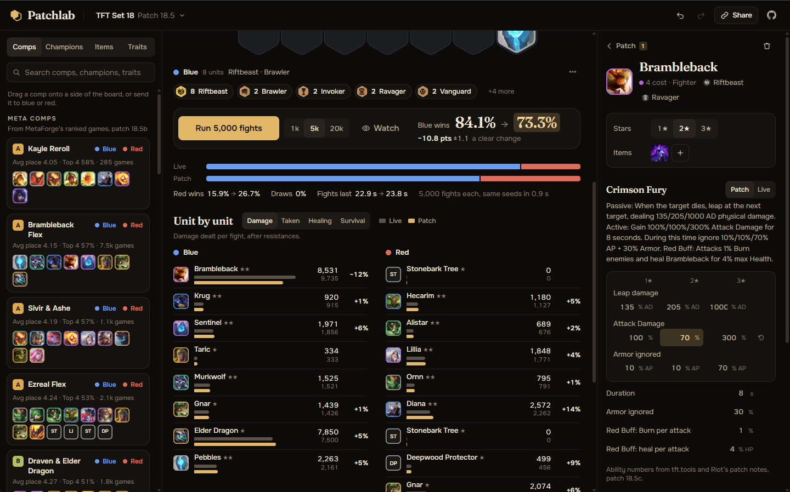
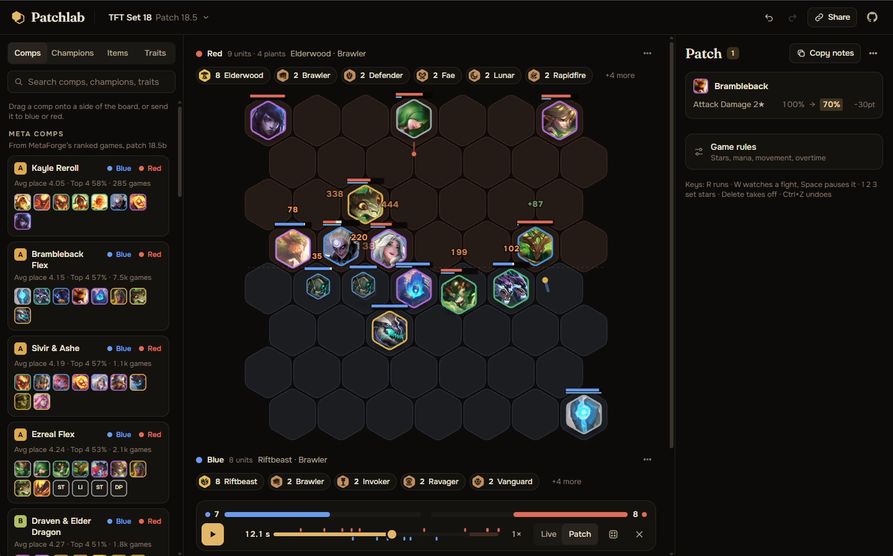
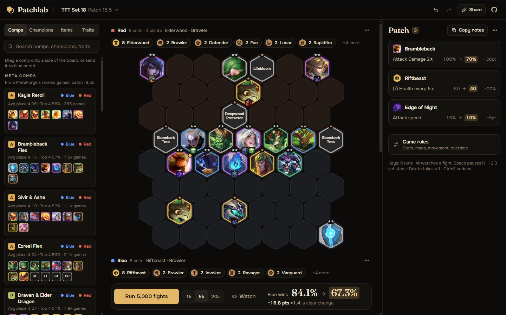

<h1 align="center">Patchlab</h1>

<p align="center">Balance sandbox for TFT</p>

<p align="center"><b><a href="https://patchlab.metaforge.lol">patchlab.metaforge.lol</a></b> · <a href="https://www.gimzdev.com/work/patchlab?utm_source=github">Case study</a></p>

<p align="center"></p>

Patchlab simulates fights in auto-battlers. Tweak a unit, an item or a trait, and two boards fight each other
thousands of times with the game's numbers and with yours, on the live Teamfight Tactics patch or any other one.

## Features

- **Sets.** Teamfight Tactics on its current patch, a built-in sandbox set, or your own game as a JSON file.
- **Fights.** TFT Set 18 plays as the game describes it: every champion's ability, each role's mana rules, and what items and traits do in combat.
- **Boards.** Champions and items drag onto the hex grid, with stars for each unit and each side's traits as in game. MetaForge's meta comps and the boards you saved are one drag away.
- **Patches.** Every number side by side, live and patched: stats, each ability's numbers per star, item effects, trait breakpoints and the game rules.
- **Runs.** Up to 20,000 seeded fights spread over your machine's cores, live and patched on the same seeds, with the margin of the result.
- **Results.** Win rates and what each unit dealt, took, healed and survived, before and after. Any fight can be watched, with every attack, cast, summon and hit on the board.
- **Share.** One link holds the whole setup, patch and result included. The result also copies as an image, the patch notes as text.
- **Patch pages.** Each TFT patch's balance changes fought out on MetaForge's meta comps ([/patch](https://patchlab.metaforge.lol/patch)).
- **MetaForge.** The team builder of [MetaForge](https://github.com/gimzdev/metaforge) opens its board here with Simulate, and its patch notes link to the patch pages.

<p align="center">   </p>

## Built with

Next.js (App Router), React, TypeScript and Tailwind CSS. The fight engine in `engine/` is plain TypeScript. Fights
run in your browser, in Web Workers, with no account and no server.

<details>
<summary>Implementation notes</summary>

- **Seeds.** A fight advances in steps of a twentieth of a second: units pick a target, walk the hex grid, attack on their attack-speed timer and cast when their mana is full. Everything random comes from a seeded generator, so the same seed gives the same fight, and any fight of a run can be watched again.
- **Paired runs.** The live and the patched numbers fight on the same seeds, fight by fight, so only the fights whose result flipped carry noise. The result is how far the win rate moved, in points, with its 95% margin.
- **Workers.** A run is cut into slices handed to a pool of Web Workers as they free up: one worker for every core but one, 8 at most, fewer on a device short of memory. Without workers, fights run on the page in short bursts.
- **Patches as data.** A balance change is a number at a path (`u.squire.armor`, `t.bulwark.b1.armor`), so a whole patch fits in a link with both boards and the result.
- **Game data.** Before each answer the site reads the version of the game's data on CommunityDragon and downloads the data again when it has changed, and no answer is kept longer than 10 minutes. Units, their stats and every trait number come from Riot's game data.
- **Limits.** Riot's game data has no ability or item numbers for Set 18, so those come from [tft.tools](https://tft.tools), kept up to date with Riot's patch notes, and the app says which patch they are from. What a single fight can't show (gold, Essence, bounties, takedown rewards) isn't simulated, and each trait says so.

</details>

## Run it

```bash
git clone https://github.com/gimzdev/patchlab.git
cd patchlab
npm ci
npm run dev        # http://localhost:3000
```

Node.js 20.9 or newer. No keys and no database. `npm run tft` downloads the current TFT set again (`npm run build`
runs it first); the copy in `sets/` is kept when the download fails.

This repository is written by one script, which also installs and deploys the app, and is pushed after each deploy.

## Licence and credits

Public domain under [CC0 1.0](LICENSE). The TFT set comes from [CommunityDragon](https://www.communitydragon.org),
Set 18's ability and item numbers from [tft.tools](https://tft.tools) (`sets/tft18-kit.json`), and the meta comps
from [MetaForge](https://www.metaforge.lol).

<sub>Patchlab isn't endorsed by Riot Games. Riot Games and all associated properties are trademarks of Riot Games, Inc.</sub>

<p align="center"><sub><a href="https://www.gimzdev.com/?utm_source=github">Gimz</a> · <a href="https://github.com/gimzdev/grimoire">Grimoire</a> · <a href="https://github.com/gimzdev/metaforge">MetaForge</a> · <a href="https://github.com/gimzdev/mosaik">Mosaïk</a> · <a href="https://github.com/gimzdev/dropdate">Dropdate</a></sub></p>
