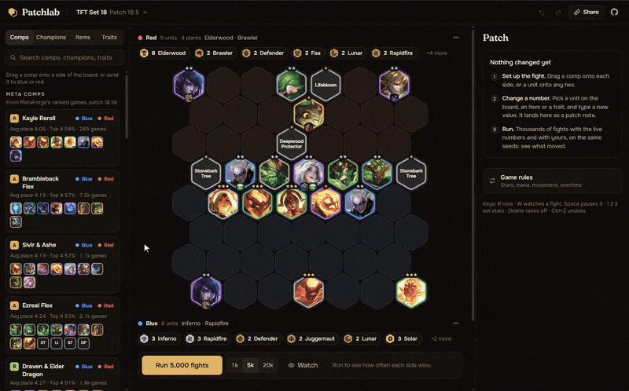
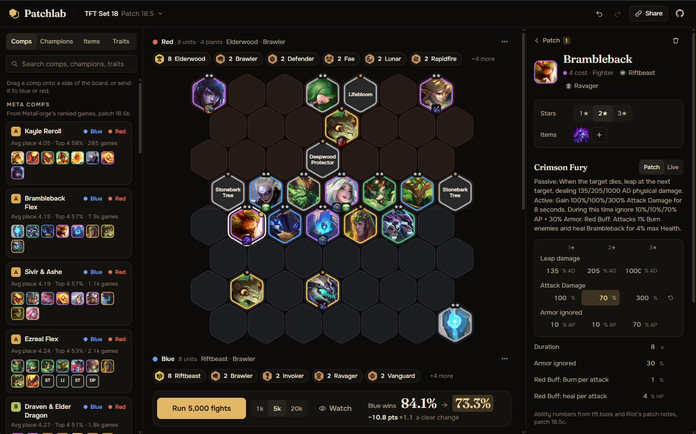
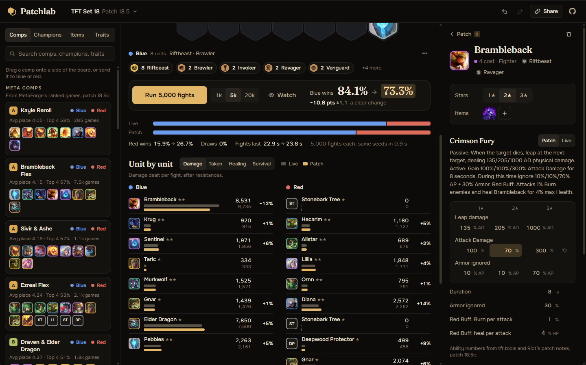
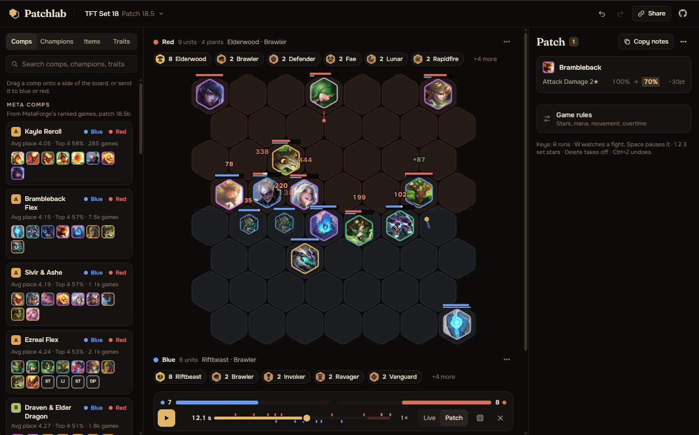
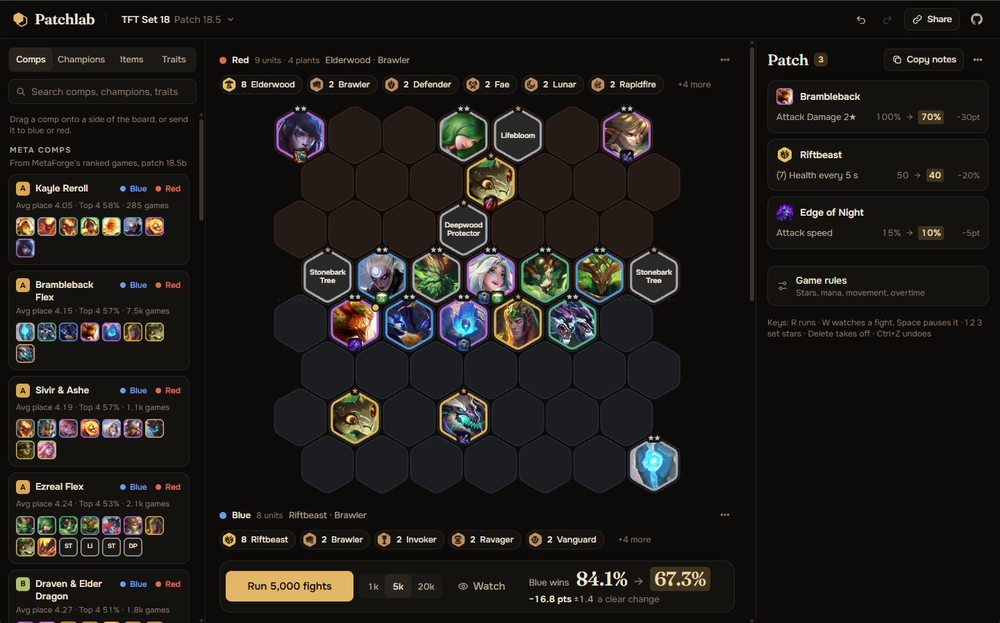

# Patchlab

Balance sandbox for auto-battlers: change a number, simulate thousands of fights, see what moves.

[patchlab.metaforge.lol](https://patchlab.metaforge.lol) · Next.js · TypeScript · Web Workers

<table>
<tr>
<td align="center" width="50%"> An ability patched and what it moved</td>
<td align="center" width="50%"> Results, unit by unit</td>
</tr>
<tr>
<td align="center" width="50%"> Watching a fight: Krug has split into Kruglettes</td>
<td align="center" width="50%"> Patch notes</td>
</tr>
</table>

Patchlab tests balance changes for auto-battlers before they ship. Fights in these games play out on their
own, so they can be simulated: change a unit, an item or a trait, fight two boards against each other
thousands of times with the live numbers and with yours, and see what moves before players find out.

| | |
|:---|:---|
| **Sets** | Teamfight Tactics on its current patch, from CommunityDragon and kept current on its own; a built-in sandbox set; or your own game as a JSON file |
| **Fights** | TFT Set 18 plays as the game describes it: every champion's ability (Krug splitting into Kruglettes, Yorick's Spirit Walker, Azir's soldiers, Zyra's plants, Gnar and Elise changing form, Elder Dragon taking flight), each role's mana rules, and what items and traits do in combat |
| **Comps** | MetaForge's meta comps, Elderwood's plants included, and boards you saved (other sets get one comp per trait): drag one onto a side or send it there in one click |
| **Boards** | Champions and items drag onto the hex grid, with stars for each unit and each side's traits as in game |
| **Patches** | Every number side by side, live and patched: stats, each ability's numbers per star, item effects, trait breakpoints and the game rules |
| **Runs** | Up to 20,000 seeded fights on every core, live and patched on the same seeds, with the margin of the result |
| **Results** | Win rates and what each unit dealt, took, healed and survived, before and after; watch any fight play out, with every attack, cast, summon and hit on the board |
| **Share** | One link holds the whole setup, patch included, and the patch notes copy as text |
| **MetaForge** | The team builder's Simulate button opens its board here, against a sample opponent |

Fights run in your browser, in Web Workers, with no account. The site opens on two meta comps that win about
as often as each other, so a patch has room to move the result either way. The TFT set is refreshed from
CommunityDragon every 6 hours, so a new patch shows up without a release: units, their stats and every trait
number come straight from Riot's game data. That data leaves out Set 18's ability and item numbers, so those
come from [tft.tools](https://tft.tools), kept up to date with Riot's patch notes, and the app says which
patch they're from; a set without them gets numbers estimated from each description, marked as such. What a
single fight can't show (gold, Essence, bounties, takedown rewards) isn't simulated, and each trait says so.
A number corrected in the Live column stays corrected in your links.

Patchlab isn't endorsed by Riot Games. Riot Games and all associated properties are trademarks of Riot Games, Inc.

